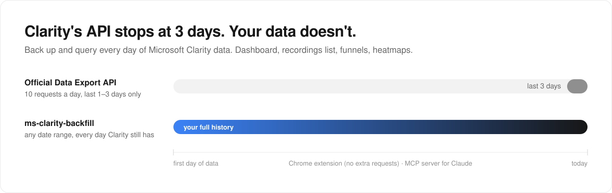
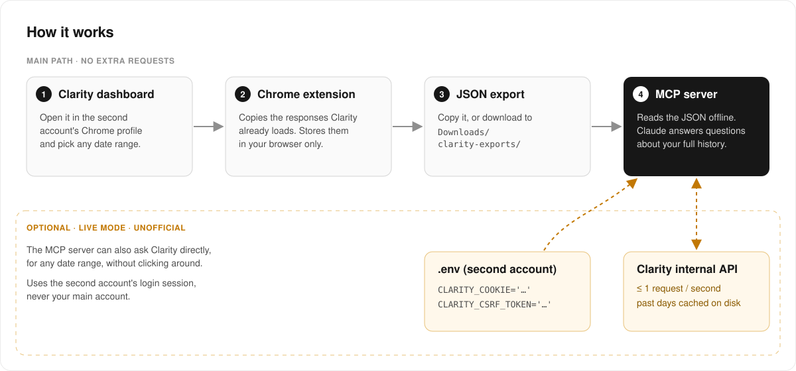
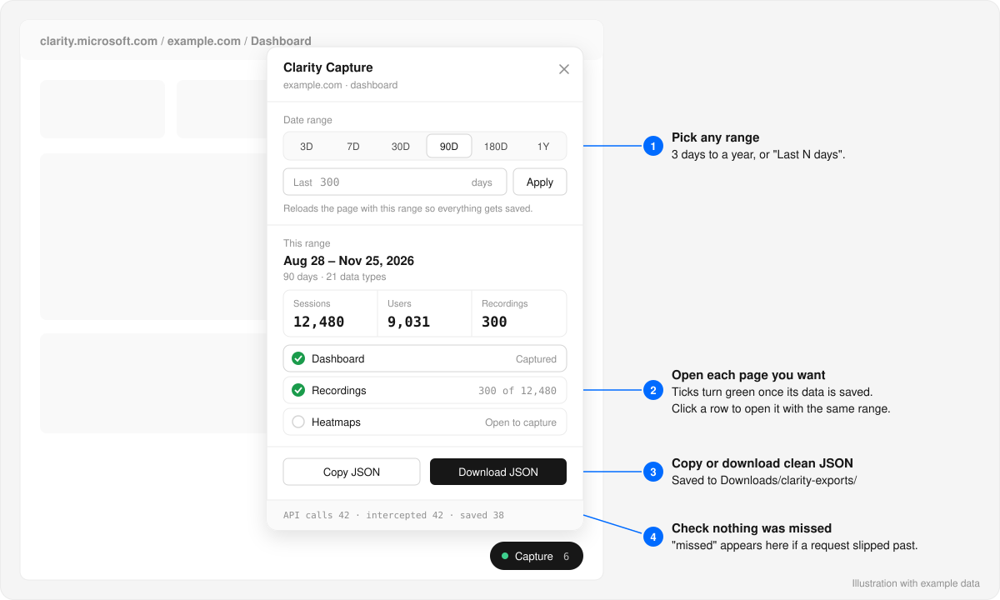
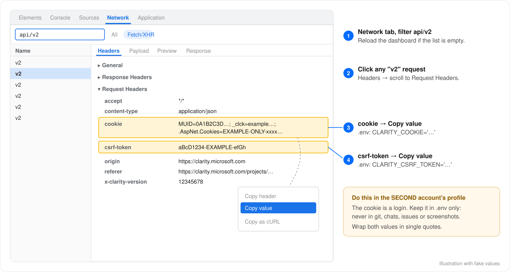

# ms-clarity-backfill

**Get all of your Microsoft Clarity data, not just the last 3 days.**

<p align="center">
  
</p>

Clarity's official Data Export API only returns the **last 1–3 days**, and only 10 requests per day. The Clarity dashboard can show much longer ranges, but there's no good way to export them.

This project gives you two tools:

- **A Chrome extension** that saves the data the Clarity dashboard loads, for **any date range**, and lets you copy or download it as clean JSON. It sends **no extra requests**.
- **An MCP server** so Claude (or any MCP client) can answer questions about that data. Optionally it can query Clarity directly for any date range.

> [!WARNING]
> **Unofficial. Not affiliated with or endorsed by Microsoft.** This uses Clarity's internal dashboard API, which can change or stop working at any time. Read [Risks](#risks) before you use it.

---

## Contents

- [What you get](#what-you-get)
- [How it works](#how-it-works)
- [Risks](#risks)
- [Quick start](#quick-start)
- [Step 1: Create a second Microsoft account](#step-1-create-a-second-microsoft-account)
- [Step 2: Install the Chrome extension](#step-2-install-the-chrome-extension)
- [Step 3: Capture your data](#step-3-capture-your-data)
- [Step 4: Set up the MCP server](#step-4-set-up-the-mcp-server)
- [Optional: live mode](#optional-live-mode)
- [Troubleshooting](#troubleshooting)
- [Privacy](#privacy)

---

## What you get

| | Official Data Export API | This project |
|---|---|---|
| Date range | Last 1–3 days | **Any range** that Clarity still has |
| Request limit | 10 per project per day | Extension: none (no extra requests). Live mode: ≤ 1 per second |
| Sessions, users, pages per session, scroll depth, engagement time | ✅ | ✅ |
| Dead clicks, rage clicks, quick backs, JS errors | ✅ | ✅ |
| Top pages, referrers, devices, browsers | ✅ | ✅ |
| Country, OS, UTM source / medium / campaign breakdowns | ✅ | ❌ |
| New vs returning, web vitals (LCP / INP / CLS), error messages, bot types | ❌ | ✅ |
| Smart events, funnels with step counts | ❌ | ✅ |
| Recordings list (entry/exit page, device, country, duration) | ❌ | ✅ |
| Heatmaps | ❌ | ✅ (page size and URL, optionally click data) |

The two work well together. Use this project for history, and the official API for UTM breakdowns.

---

## How it works

<p align="center">
  
</p>

1. You open the Clarity dashboard and pick a date range, as usual.
2. Clarity's page loads its data from `clarity.microsoft.com/api/v2`. The extension **copies those responses** as they arrive. It never sends a request of its own.
3. You copy or download the result as one clean JSON file.
4. The MCP server reads those files, so Claude can answer questions such as "How did dead clicks change between March and October?"

**Optional live mode:** the MCP server can call the same internal API itself, using a login session from a *second* account. That way it can pull any date range or per-day history without you clicking around.

---

## Risks

Please read this before you use the project.

| Risk | What it means | How this project reduces it |
|---|---|---|
| **Unofficial API** | Clarity's internal API isn't documented or supported. Microsoft can change it at any time, and this project would then stop working until it's updated. | Everything is in a few small files, so fixes are small. |
| **Terms of use** | Automated access to non-public interfaces may go against Microsoft's or Clarity's terms. Check them yourself. | The extension only reads what your browser already loaded. Live mode is opt-in. |
| **Account could be flagged or blocked** | Heavy or unusual automated use could get the account restricted. | Use a **second account** (below), so your main account is never at risk. Live mode is limited to ≤ 1 request per second, one at a time, and caches past days so they're never fetched twice. |
| **Your login cookie is sensitive** | Live mode needs your session cookie. Anyone who has it can use that Clarity account until it expires. | It stays in `.env`, which is git-ignored, and is only sent to `clarity.microsoft.com`. |
| **Visitor data** | Exports include your visitors' city, device and pages visited. You're responsible for handling this under GDPR or your local privacy law. | Data stays on your machine. Exports are git-ignored. |

**If you're not comfortable with these risks,** use only the official Data Export API. Save it every day and you'll build up history from now on, without any of these risks.

---

## Quick start

1. Create a **second Microsoft account** and add it to your Clarity project as a Member.
2. Load the **Chrome extension** in that account's Chrome profile.
3. Open Clarity, pick a range in the **Capture** panel, and download the JSON.
4. *(Optional)* Add the **MCP server** to Claude Code.
5. *(Optional)* Turn on **live mode** with that account's cookie and CSRF token.

Each step is explained below.

---

## Step 1: Create a second Microsoft account

This keeps your main Microsoft account (and everything else it's used for, such as Outlook) out of any risk.

1. Create a new account at [signup.live.com](https://signup.live.com). Don't link it to your main account, so use a different recovery email and phone.
2. With your **main** account, open your Clarity project → **Settings → Team → Add team member**. Enter the new account's email and choose **Member**. Members can view all data.
3. In Chrome, click your profile icon → **Add** to create a **new Chrome profile**. In that profile, sign in to [clarity.microsoft.com](https://clarity.microsoft.com) with the new account and accept the invite.
4. From now on, use **only that profile** for this project. Don't use the new account for anything else.

If the second account is ever blocked, remove it from the team and create another. Your main account isn't affected.

---

## Step 2: Install the Chrome extension

1. Download this repository (**Code → Download ZIP**, then unzip it), or clone it:
   ```bash
   git clone https://github.com/heysujal/ms-clarity-backfill.git
   ```
2. In the **second account's** Chrome profile, open `chrome://extensions`.
3. Turn on **Developer mode** (top right).
4. Click **Load unpacked** and select the `extension/` folder.
5. Pin the extension, then refresh any Clarity tabs you already have open.

---

## Step 3: Capture your data

<p align="center">
  
</p>

1. Open your Clarity project. A black **Capture** button appears in the bottom-right corner. Click it.
2. **Pick a range:** 3D, 7D, 30D, 90D, 180D, 1Y, or type "Last N days" for anything longer (for example 300). The page reloads with that range.
3. **Open each page you want:** Dashboard, Recordings, Heatmaps. Each one gets a green tick once its data is saved. Click a row to open that page with the same range.
   - **Recordings:** each page of 100 recordings you scroll through in Clarity is saved.
4. Click **Copy JSON** or **Download JSON**. Downloads go to `Downloads/clarity-exports/`.
5. Check the line at the bottom of the panel. If it says **"missed"**, some requests weren't captured. Reload the page and try again.

The toolbar popup and **Full view** (an extension page) list everything you've captured, with Copy and Download buttons for each range.

<details>
<summary><b>What's in the JSON?</b></summary>

```jsonc
{
  "format": "clarity-capture-export",
  "version": 1,
  "projects": { "<projectId>": { "name": "...", "hostname": "...", "funnels": [ ... ] } },
  "views": [
    {
      "projectId": "...",
      "fromDate": "2026-08-28",
      "toDate": "2026-11-25",
      "days": 90,
      "summary": {
        "sessions": 12480, "uniqueUsers": 9031, "pagesPerSession": 2.5,
        "scrollDepthPercent": 41.2, "avgActiveTimeSec": 55,
        "deadClicksSessions": 1366, "rageClicksSessions": 25, "quickBacksSessions": 2021,
        "jsErrorsSessions": 136, "performanceScore": 83.7, "lcpMs": 1892, "inpMs": 272
      },
      "metrics":  { "topPathsWithTitleAndParams": [ ... ], "referrers": [ ... ], "devices": [ ... ],
                    "browsers": [ ... ], "smartEvents": [ ... ], "topErrorsBreakdown": [ ... ], ... },
      "funnels":  [ { "name": "Signup", "steps": [ { "name": "Pricing", "sessions": 3206 }, ... ] } ],
      "sessions": [ { "sessionStartIso": "...", "entryUrl": "...", "device": "Mobile", "country": "...", ... } ],
      "heatmaps": [ { "url": "...", "width": 390, "height": 4200 } ]
    }
  ]
}
```

*Example values.* `newUserSessions` + `returningUserSessions` add up to total sessions, because Clarity counts sessions, not people.
</details>

---

## Step 4: Set up the MCP server

Needs [Node.js](https://nodejs.org) 23.6 or newer. There's no build step.

```bash
cd mcp-server
npm install
claude mcp add clarity -- node "$(pwd)/src/index.ts"
```

Restart Claude Code. That's all that's required. The server reads exports from `~/Downloads/clarity-exports/`, and doesn't need any network access or `.env`.

| Tool | What it does |
|---|---|
| `clarity_status` | Shows what's been captured and whether live mode is on |
| `clarity_list_captured` | Lists captured projects and date ranges |
| `clarity_get_captured` | All metrics for a captured range |
| `clarity_search_captured_recordings` | Filter recordings by country, device, browser, URL, referrer |

Try asking Claude: *"Use clarity_list_captured, then compare the last 90 days with the 90 days before."*

---

## Optional: live mode

Live mode lets the MCP server fetch **any date range** and **per-day history** directly, without the extension. It's unofficial, so read [Risks](#risks) first, and always use the **second account**.

### Get the cookie and CSRF token

<p align="center">
  
</p>

1. In the **second account's** Chrome profile, open your Clarity project's Dashboard.
2. Press **F12** and open the **Network** tab. Type `api/v2` in the filter box, and reload the page if the list is empty.
3. Click any **`v2`** request → **Headers** → scroll to **Request Headers**.
4. Right-click the **`cookie`** value → **Copy value**.
5. Right-click the **`csrf-token`** value → **Copy value**.
6. In the project folder, copy the example config:
   ```bash
   cp .env.example .env
   ```
7. Paste both values into `.env` **inside single quotes**:
   ```bash
   CLARITY_COOKIE='paste-cookie-here'
   CLARITY_CSRF_TOKEN='paste-csrf-token-here'
   ```
   The quotes matter. The cookie contains `;`, `=` and sometimes `#`, and without quotes the value is cut short.
8. Restart Claude Code. Ask it to run `clarity_status`. It should show `"live": { "configured": true }`.

### Live tools

| Tool | What it does | Requests |
|---|---|---|
| `clarity_live_projects` | Projects the second account can see | 1 |
| `clarity_live_dashboard` | All dashboard metrics for any date range | Usually 1 |
| `clarity_live_daily` | One row per day; past days cached on disk | 1 per new day (max 60 per call) |
| `clarity_live_recordings` | Recordings list for a date range | 1 per 100 |
| `clarity_live_funnels` | Every funnel with step counts | Usually 2 |

Built-in limits: one request at a time, at least 1 second apart; stops after repeated errors or rate limiting.

### When the session expires

Tools will return `AUTH: ...`. Log in again in the second profile, repeat the steps above, and restart.

### Optional settings (`.env`)

| Variable | Default | Purpose |
|---|---|---|
| `CLARITY_DEFAULT_PROJECT` | none | So you don't have to pass `projectId` every time |
| `CLARITY_EXPORT_DIR` | `~/Downloads/clarity-exports` | Where the extension's downloads are |
| `CLARITY_MIN_INTERVAL_MS` | `1200` | Gap between live requests (never below 1000) |
| `CLARITY_CACHE_DIR` | `~/.clarity-mcp/cache` | Where per-day results are cached |

---

## Troubleshooting

| Problem | Fix |
|---|---|
| No **Capture** button on Clarity | Refresh the tab. If you just updated the extension, click its reload icon in `chrome://extensions` first. |
| Changing the range in Clarity's own date picker isn't captured | Pick the range from the **Capture panel** instead. It reloads the page, which always captures. |
| Panel says **"missed"** | Reload the page. If it keeps happening, [open an issue](https://github.com/heysujal/ms-clarity-backfill/issues) with the numbers from that line (no data or cookies). |
| Export has only some metrics | Wait for the Dashboard to finish loading before downloading. Each page (Dashboard, Recordings, Heatmaps) is captured only after you open it. |
| MCP shows nothing captured | Check that the files are in `~/Downloads/clarity-exports/`, or set `CLARITY_EXPORT_DIR`. |
| Live tools return `AUTH:` | The session expired. Copy a fresh cookie and CSRF token. |
| Live tools aren't listed | `CLARITY_COOKIE` or `CLARITY_CSRF_TOKEN` is missing from `.env`. Restart after editing. |

---

## Privacy

- **The extension** stores captured data only in your browser (`chrome.storage.local`) until you download it. It never saves your account details or Clarity's own telemetry. Use **Clear** in the popup to delete everything.
- **The MCP server** reads local files. In live mode it talks **only** to `clarity.microsoft.com`.
- **Nothing is sent anywhere else**: no analytics, no third-party servers.
- `.gitignore` excludes `.env`, session files, `*.har` files and exported `clarity_*.json` data.

**Never share** your `.env`, cookie, HAR files or exports in issues, chats or screenshots. If a cookie leaks, sign out of Clarity in that profile to end the session.

---

<sub>Microsoft and Clarity are trademarks of Microsoft Corporation. This project is not affiliated with, endorsed by or sponsored by Microsoft. The Geist fonts in `extension/fonts/` are by Vercel, under the SIL Open Font License.</sub>
